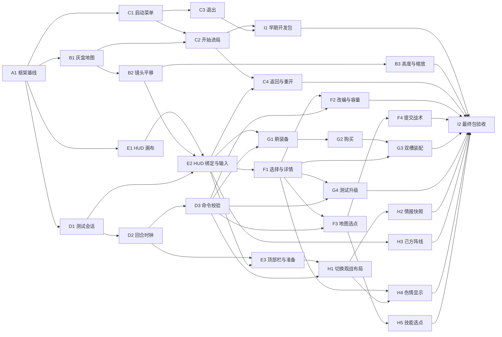

# M1：从主菜单进入空战场，跑通局内 UI

**里程碑验收：** 在 Windows 开发包里，从只有「开始游戏」「退出」的主菜单直接进入一张空战场。测试者能浏览地图、改编测试营、操作装备和指挥面板，观察一轮状态变化，进入下一轮部署，再返回主菜单重新开始。全程不需要编辑器、控制台、账号或大厅。

**拆分方式：9 个功能父项，29 个可领取的叶子 issue。** 每张叶子卡只负责一个可验证结果；父项用来汇总，不单独承担开发工作。编号是规划代号，创建时再映射成 GitHub issue 号。文中地图名、测试输入和按键是本里程碑的实现建议；金币、升级和控制区使用固定数据，不替正式玩法定数值。

## 拓扑与并行顺序

箭头表示验收依赖。先让主菜单和地图在开发包中跑通（I1），不必等所有 UI 结束才发现 cook 配置有误。UI 骨架 E1 和测试状态 D1 可并行；二者汇合后，营编制、装备和观战各自推进。下图显示主要交接点；每张卡的完整直接依赖见卡片。

## 叶子 issue 卡片

每张卡可直接复制到 GitHub：标题用下面的编号和动作，正文保留「依赖、交付、验收」。UI 卡附截图或短录屏；逻辑卡附可复跑的测试步骤与结果。正式战斗、行军 AI、真实控制度算法、完整联机流程、第二张地图和最终美术均不作为 M1 的关闭条件。

### A · 工程基线

#### A1 · 交付可从干净检出构建的框架

- **依赖：** 无。
- **交付：** 将已有 Framework、模块依赖和框架指南作为一个基线变更；排除本地 PDF、缓存和 DLL。
- **验收：** 另一工作目录用 UE 5.8 编译 HOMG2Editor 成功；执行 HOMG2.Framework，两条既有测试通过，记录命令和结果。

### B · 灰盒地图与镜头

#### B1 · 创建可独立打开的灰盒战场

- **依赖：** A1。
- **交付：** 制作 L_M1_Field：平地、光照、PlayerStart、双方指挥部占位和有界的场地；不放模板敌人。
- **验收：** 直接从地图 PIE 可见地面和两个可区分的指挥部；没有模板角色或模板 HUD。

#### B2 · 接管战场镜头并限制平移范围

- **依赖：** B1。
- **交付：** 建立战场 GameMode、俯视 Pawn 与继承框架的玩家控制器；绑定 WASD 平移，关卡指定出生视点和边界。
- **验收：** 四方向均可移动；持续向边界外移动不会丢失地图；离开关卡后输入映射被移除。

#### B3 · 分离镜头缩放和高度调整

- **依赖：** B2。
- **交付：** 滚轮调镜头远近，独立按键调观察高度；为两者分别设可配置上下限。
- **验收：** 分别测试两类输入及两个极限值：能观察全局和局部，不穿过地面，不会把镜头永久卡住。

### C · 主菜单与进出局

#### C1 · 设定启动地图与双按钮菜单

- **依赖：** A1。
- **交付：** 制作 L_M1_Menu、菜单 Widget 和菜单输入模式；将其设为 GameDefaultMap，不修改模板地图资产。
- **验收：** Standalone 启动不用控制台，屏幕仅有「开始游戏」「退出」两个动作；键鼠可聚焦并触发按钮。

#### C2 · 接通「开始游戏」并防重复加载

- **依赖：** C1、B1。
- **交付：** 将开始按钮绑定到战场地图，接受一次后禁用，加载结束由战场控制器接管输入。
- **验收：** 连续点击开始只触发一次切图；进入 L_M1_Field，无大厅、模板菜单或残留鼠标焦点。

#### C3 · 接通「退出」到独立进程退出

- **依赖：** C1。
- **交付：** 由主菜单退出动作结束游戏；PIE 与独立进程分开验收。
- **验收：** 从 Standalone 主菜单点退出，游戏进程结束；编辑器本身不退出。

#### C4 · 实现局内 Esc 返回与重复开局

- **依赖：** C2、E2。
- **交付：** 局内 Esc 显示继续/返回主菜单；离局释放会话、Widget、镜头输入及委托。
- **验收：** 从战场返回再开两次，每次只有一个 HUD、一套输入、第一轮初始数据；「继续」不重置本局。

### D · 对局状态与功能接口

#### D1 · 提供唯一的本地 M1 测试会话

- **依赖：** A1。
- **交付：** 建立随对局创建/销毁的测试状态源：轮次、阶段、金币、营、成员及装备使用稳定 ID；提供只读快照和变化通知。
- **验收：** 两个独立会话不共享余额或库存；订阅者收到变更，后创建的界面可立即读到当前值，重开恢复夹具初值。

#### D2 · 跑通两分钟以内的回合时钟

- **依赖：** D1。
- **交付：** 模型驱动部署→观战→结算→下轮，提供准备操作；阶段时长可缩短以便测试。
- **验收：** 自动或提前准备均只切换一次；第二轮轮次加一；默认完整循环≤120 秒，Widget 不负责推进时间。

#### D3 · 统一部署命令的阶段校验与失败反馈

- **依赖：** D2。
- **交付：** 提供共享的阶段校验和命令结果：成功/拒绝原因；由后续各功能添加具体操作，不造全局总线。
- **验收：** 在部署期发同一个测试操作成功；观战期直接绕过按钮调用仍拒绝，状态不变，原因可显示。

### E · 局内 HUD 与输入

#### E1 · 创建局内 HUD 画布与响应式分区

- **依赖：** A1。
- **交付：** 用静态夹具排出顶部状态栏、左侧营列表、右侧详情、底部操作栏和全屏地图提示层。
- **验收：** 在 1280×720 与 1920×1080 各留一张图；按钮不出屏、详情可滚动、中央留有可点地图的区域。

#### E2 · 绑定 HUD 生命周期与地图输入优先级

- **依赖：** E1、B2、D1。
- **交付：** 本地玩家进战场创建 HUD，绑定当前会话；区分面板命中与地图命中，离局解除绑定。
- **验收：** 点面板不落地图指令；关闭面板后平移镜头正常；重复绑定一次变更只刷新一次。

#### E3 · 用会话状态驱动顶部栏与准备按钮

- **依赖：** E2、D2。
- **交付：** 绑定轮次、阶段、剩余时间、金币；准备按钮发送意图，不自行改阶段。
- **验收：** 准备后显示观战并禁用重复准备；结算后显示下一轮；修改模型余额能同步到栏位。

### F · 营编制与指挥

#### F1 · 在地图标记、营列表和详情间同步选择

- **依赖：** E2。
- **交付：** 放一个可选灰盒营标记，地图和列表共用营选择；详情绑定成员、在途与容量。单位视图复用已有 Presenter/快照。
- **验收：** 从两处选择同一营，另一处同步高亮；清除选择后详情为空，点击列表不移动营。

#### F2 · 提交增减员并验证九人容量

- **依赖：** F1、D3。
- **交付：** 改编面板展示可用成员、现员、在途；增加先进入在途，用测试事件完成到达；减员更新所属关系。
- **验收：** 用 8 现员 + 1 在途申请第 10 人被拒；模拟到达后为 9 现员 + 0 在途；增减前后营 ID 与坐标不变。

#### F3 · 实现营指令的地图选点与取消

- **依赖：** F1、B2、D3。
- **交付：** 点击「选目标」进入选点态，悬停预览、点击写入草稿，Esc 只取消此次选点。
- **验收：** 在测试己方/敌方地块分别预览为防守/进攻；取消不改变上次已提交目标，也不打开离局菜单。

#### F4 · 提交激进/保守并回显已保存命令

- **依赖：** F3。
- **交付：** 将战术开关与目标点一起提交；模型保存后再驱动详情与地图标识。
- **验收：** 提交后取消选择再选中，目标和战术仍一致；切到观战后不能再用部署面板改令。不做营 AI。

### G · 装备商店与升级

#### G1 · 让 D 键和刷新按钮走同一装备刷新操作

- **依赖：** E2、D3。
- **交付：** 个人装备商店显示固定测试序列；D 键与按钮调用同一操作，扣测试刷新费并更新货架。
- **验收：** 一次输入只扣一次钱；不会抽出士兵；两个测试玩家的货架互不影响；余额不足时货架、余额均不变。

#### G2 · 从货架购买并写入个人库存

- **依赖：** G1。
- **交付：** 装备卡显示名称、特化标签和测试价格；购买成功把该实例移入库存并标记已售。
- **验收：** 购买前后核对余额、库存及售出状态；重复点击不会得到第二份；失败显示原因。

#### G3 · 给选中士兵装配、替换和卸下双特化

- **依赖：** G2、F1。
- **交付：** 成员详情提供两个具名槽位；选择库存物品装到指定槽，替换时旧件回库存。
- **验收：** 装满两槽后替换其中一件，再卸下另一件；每件物品只在一个位置，切换士兵后显示正确。

#### G4 · 接通一次可验证的测试升级

- **依赖：** F1、D3。
- **交付：** 展示当前等级、升级消耗和下一级变化，调用测试升级命令；消耗配置不决定正式配方。
- **验收：** 资源充足时等级加一且只扣一次；不足时保持原等级；重新打开详情能读回新等级。

### H · 观战、情报与技能

#### H1 · 切换部署和观战两套布局

- **依赖：** E3、D3。
- **交付：** 以同一个 HUD 根节点切布局；观战收起商店和改编入口，保留镜头、状态与只读详情。
- **验收：** 连续两轮转换没有叠加 Widget；观战中 D 键不能扣费；下一轮部署恢复入口。

#### H2 · 显示交火信息和上轮灰色情报快照

- **依赖：** H1。
- **交付：** 准备两处测试标记，其中一处从未获准显示；模拟交火和回合末快照，复用按玩家过滤的数据入口。
- **验收：** 观战仅见获准交火标记；次轮规划只见上轮已知位置且标灰；后台移动敌方测试标记不改变旧快照。

#### H3 · 在灰盒战场叠加己方阵线预览

- **依赖：** B1、E2。
- **交付：** 使用固定己方折线和两组测试控制地块驱动地图叠层；提供替换为真实控制度数据的入口。
- **验收：** 切换样例快照后己方线更新，敌方线始终不渲染；镜头缩放后线仍对应同一地面位置。不实现拟合算法。

#### H4 · 用已授权快照更新营与单兵的状态显示

- **依赖：** H1、F1。
- **交付：** 观战详情展示营组织状态和成员伤情；用一条测试事件令单兵从正常变为重伤。
- **验收：** 一次变更同时更新详情与场景标记；两处都不显示生命/组织度数值，失去授权后不留下单位详情。

#### H5 · 复用一个地图选点流程接入技能栏

- **依赖：** F3、D3。
- **交付：** 建立四种工事和空军的测试技能条目，复用选点、预览、取消、提交；结果显示「测试预览」及位置。
- **验收：** 分别试用一个工事与一个空军条目；取消无记录，合法提交只有一条记录，越界拒绝；不生成真实伤害。

### I · 打包与验收

#### I1 · 验证 Windows 开发包的启动与地图烘焙

- **依赖：** C2、C3。
- **交付：** 配置菜单和战场地图进入 cook 列表，产出早期 Win64 Development 包，记录可重复的打包步骤。
- **验收：** 在不启动编辑器的条件下，从可执行文件开始、进入战场、退出；日志无地图缺失。此项不用等局内 UI 全部完成。

#### I2 · 完成整局验收并交付带版本号的构建

- **依赖：** I1、B3、C4、F2、F4、G3、G4、H2、H3、H4、H5。
- **交付：** 从最终版本重新打包；附构建获取方式、版本、部署/观战截图和验收记录。
- **验收：** 在同一个包内跑通开始→D牌→买装→双槽装配→改编→下令→观战→次轮→返回→重开→退出；再跑空库存、容量满、金币不足三种拒绝路径。

## 后续创建到 GitHub 的方式

- 建一个仓库 Milestone：**M1 · 从主菜单进入空战场**。其下创建 A–I 九个功能父 issue；上面的叶子卡作为对应父 issue 的原生 sub-issue。Milestone 已汇总整体验收，不再额外创建一张同名总 issue。
- 为九个父项和所有叶子卡显式设置同一个 Milestone，并加入目标 Project。执行看板只显示叶子卡，按 Status 分列；汇总表按 Parent issue 分组，展示负责人和依赖。先批量创建获得真实编号，再回填每张卡的 blocked-by，避免把规划代号误写成 issue 号。
- 父子关系用于分工，依赖用于排顺序。例如 G3 属于装备父项，但它既等 G2 的库存，又等 F1 的士兵选择；不用等整个营编制功能做完。父项在全部子项验收后关闭，Milestone 以 I2 的最终开发包为准。
