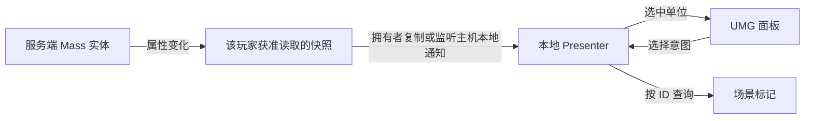

# HOMG2 框架

框架位于 [game/Source/HOMG2/Framework](../../game/Source/HOMG2/Framework/)。它解决两个问题：单位属性在服务端只有一个来源；同一份允许公开的信息能更新界面和场景。工程仍使用原有 HOMG2 模块、地图与输入配置。在自己的 GameMode 里选用框架即可，不必从 Strategy 或 TwinStick 派生。

**第一次使用：** [开发指南](开发指南.md)包含接入步骤、蓝图事件、独立示例和双人检验方法。

| 目录 | 负责什么 | 生命周期 |
| --- | --- | --- |
| Simulation | UUnitModel 操作 UE 5.8 MassEntity；身份和生命值保存在 Fragment 中。 | 每个游戏 World 独立，写操作只接受服务端或单机调用。 |
| Network | AFrameworkPlayerController 持有 UUnitFeed。服务端逐玩家授权，将 FUnitSnapshot 数组仅复制给拥有者。 | 随该玩家的 Controller 创建和销毁；没有全局广播的单位列表。 |
| Presentation | UUnitPresenter 管本地选择，UUnitPanel 显示选中单位，UUnitMarker 跟踪一个固定 ID。 | 每个本地 Controller 一个 Presenter；面板、标记可以随时创建和释放。 |
| Dev / Tests | 可单独启动的演示模式和自动化测试。 | 正式玩法不引用这些类型；测试操作在 Shipping/Test 构建中不生效。 |

以受伤为例：游戏规则调用 SetHealth；Model 将内部数值映射为伤情；Feed 仅更新自己已授权的条目。玩家能看到“重伤”，看不到具体生命值和他人私有单位。相同伤情下的数值波动无需重新复制。监听主机直接收到本地通知，远端在 OnRep 后走相同的表现路径。撤销授权或删除实体时，两类 View 都会清除显示。

**边界：** FGuid 用于引用单位，FMassEntityHandle 仅在本机当前 World 有意义。选择对局单位是本地意图；会改变玩法的请求必须由服务端校验。示例的授权来源是“每人自己的测试单位”，日后让侦察或阵营规则调用 Grant/Revoke 即可；不要先把全图数据复制给所有人再从 UI 隐藏。场景 Actor 的网络相关性也需要业务单独控制，隐藏标记不能隐藏其他途径复制的 Actor。

**什么时候扩展：** 单次升级、治疗等事件直接调用 Model；大量实体需要按相同节奏更新时再加入 Mass Processor。当前快照用简单数组，适合验证链路。只有观测到带宽或视图刷新瓶颈后，再考虑增量复制、按实体通知。地图切换、相机、寻路和动画仍使用 UE 本身的对象，不必一律改成 Presenter 或 Fragment。
